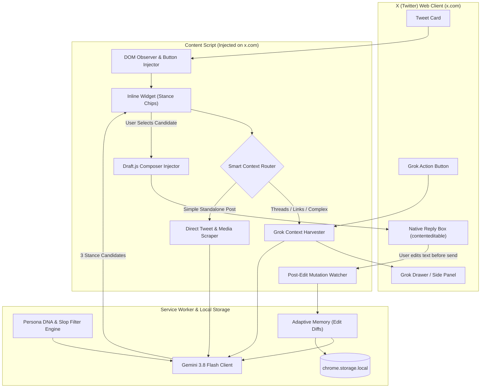

# Implementation Plan: X (Twitter) Persona-Based Reply Extension

An intelligent Chrome Extension (Manifest V3) that generates authentic, in-character replies to posts on X (Twitter). The extension extracts rich post context (leveraging X's **Grok Explain** for news, threads, and external links alongside direct DOM scraping), mirrors the user's authentic writing style from past replies (eliminating AI clichés and capturing casing/punctuation quirks), learns continuously from user edits via **Adaptive Memory**, and injects suggested replies into X's composer for review.

---

## User-Approved Requirements & Architecture Decisions

> [!IMPORTANT]
> **Key Approved Decisions:**
> 1. **Smart Grok Context Triggering**: Direct text extraction for simple tweets (instant, 0 latency); automated Grok explanation extraction for threads, link-heavy news, or complex posts where deep backstory is needed.
> 2. **Anti-AI-Slop & Typography Persona DNA**: Strict negative constraints (no generic corporate praise like "Spot on!", no cliché emojis, no listicles) + typography extraction (all-lowercase, punctuation quirks, sentence length distribution, slang).
> 3. **Stance Chips**: Inlines 3 generation vibes (`[🤝 Casual Banter]`, `[🧠 Insightful / Value-Add]`, `[🔥 Witty / Hot Take]`).
> 4. **Adaptive Memory**: When you tweak or edit an injected reply before posting, the extension locally tracks the edit delta to continuously refine your personal vocabulary and style.
> 5. **Account Safety**: Text is safely injected into X's native Draft.js editor (`div[role="textbox"]`) with synthetic input events for human review before sending.

---

## System Architecture



---

## Technical Specifications by Component

### 1. Smart Grok & Direct Context Extractor (`src/content/contextExtractor.ts`)
- **Smart Routing Heuristic**:
  - Checks if tweet contains external links (`a[href*="t.co"]`), media/video, quote-tweets (`div[role="link"]`), or is part of a multi-tweet thread.
  - If complex: Automatically clicks the tweet's Grok icon, awaits the response in the Grok drawer via `MutationObserver`, extracts the distilled background summary, and auto-collapses the drawer.
  - If simple text: Extracts tweet text, author, and media alt descriptions instantly without opening Grok.
  - Manual override: User can click "Explain with Grok first" at any time.

### 2. Persona DNA & Anti-Slop Engine (`src/services/personaEngine.ts`)
- **Extraction Pipeline**:
  - Ingests 25–50 of the user's past replies from `x.com/<handle>/with_replies`.
  - Analyzes stylistic fingerprints:
    - **Casing & Punctuation**: Capitalization habits (e.g. strict lowercase starts, missing trailing periods, semicolon avoidance).
    - **Vocabulary & Slang**: Common phrases, tech abbreviations (`tbh`, `ngl`, `w/`, `imo`), typical contractions.
    - **Length Distribution**: Median word count (e.g. 5–15 words).
    - **Tone & Humor**: Cynical, curious, supportive, dry, banter.
  - **Negative Rules (Anti-Slop)**:
    - Banned openers: *"Spot on!", "Fascinating perspective", "Couldn't agree more!", "This!", "Great point!"*
    - Banned formatting: Numbered lists, corporate pitch speak, exclamation mark overuse.
    - Banned emojis: Rocket 🚀, fire 🔥 (unless specifically matching user's persona).

### 3. Adaptive Memory Engine (`src/services/adaptiveMemory.ts`)
- **How It Learns From You**:
  - When you click a candidate reply, the initial text is saved in a temporary buffer.
  - As you type edits in the reply box, `EditTracker` captures the final text right before the tweet is submitted.
  - Computes a simple semantic/word-level diff (e.g., replaces formal words with casual phrasing, cuts length by 50%).
  - Appends learned nuances to a local "Personal Style Refinements" list in `chrome.storage.local`.

### 4. Inline Reply UI & Stance Selector (`src/content/replyWidget.ts`)
- Injects a discrete `[ ✨ Reply As Me ]` button next to the native reply icon in tweet action bars.
- Clicking expands a compact popover with 3 quick stances:
  1. `[🤝 Casual Banter]` (Natural, friendly, matching your typical conversation style)
  2. `[🧠 Insightful]` (Adds a unique angle or technical perspective)
  3. `[🔥 Witty / Hot Take]` (Dry humor, contrarian view, or punchy one-liner)
- Clicking any option automatically injects the text into X's `role="textbox"` with simulated `InputEvent` dispatch.

### 5. Extension Popup & Persona Studio (`src/popup/`)
- **Voice DNA Overview**: View current persona traits, casing rules, and vocabulary.
- **1-Click Profile Sync**: Button to scrape and rebuild Persona DNA from your live profile.
- **Manual Customizer**: Sliders for brevity, sarcasm, and technical depth + custom rules text area.
- **Settings**: Gemini API key, Grok drawer behavior (auto-collapse on/off), Grok smart-mode toggle.

---

## Proposed Project File Structure

Target directory: `C:\Users\anups\.gemini\antigravity\scratch\x-persona-reply-extension`

```
x-persona-reply-extension/
├── manifest.json                  # Manifest V3 configuration
├── package.json                   # Dependencies: @google/genai, vite, typescript, tailwindcss
├── tsconfig.json                  # TypeScript config
├── vite.config.ts                 # Multi-entry build configuration
├── tailwind.config.js             # Styling config matching X (Dark/Dim/Light)
├── src/
│   ├── background/
│   │   └── serviceWorker.ts       # Handles LLM requests, storage & messaging
│   ├── content/
│   │   ├── index.ts               # Main content script entry
│   │   ├── domObserver.ts         # Tweet detection & action bar observer
│   │   ├── contextExtractor.ts    # Smart routing (Grok vs Direct tweet context)
│   │   ├── grokScraper.ts         # Grok drawer automation & extraction
│   │   ├── replyWidget.ts         # Inline action button & 3-stance chip UI
│   │   ├── composerInjector.ts    # Draft.js contenteditable injection
│   │   ├── editTracker.ts         # Watches user tweaks for Adaptive Memory
│   │   └── styleSync.ts           # Profile reply harvester
│   ├── services/
│   │   ├── llmService.ts          # Gemini 3.8 Flash SDK integration
│   │   ├── personaEngine.ts       # Persona DNA extractor & anti-slop prompt builder
│   │   ├── adaptiveMemory.ts      # Edit diff tracking & style refinement
│   │   └── storage.ts             # Typed chrome.storage wrapper
│   └── popup/
│       ├── index.html             # Persona Studio popup UI
│       ├── popup.ts               # Popup logic & settings management
│       └── popup.css              # Popup styles
```

---

## Verification Plan

### Automated Build Verification
1. **Compilation & Packaging**:
   ```powershell
   cd C:\Users\anups\.gemini\antigravity\scratch\x-persona-reply-extension
   npm install
   npm run build
   ```
   Ensures TypeScript compiles without errors and Vite generates clean bundles in `dist/`.

### Manual End-to-End Verification on X (Twitter)
1. **Load Extension in Chrome**:
   - Navigate to `chrome://extensions/`, enable Developer Mode, click **Load unpacked**, and select the `dist/` directory.
2. **Setup Persona**:
   - Open popup, enter Gemini API key, click **Analyze Profile Replies** (or load sample tweets).
   - Verify Persona DNA card displays correct casing quirks, median length, and anti-slop rules.
3. **Smart Grok & Context Test**:
   - On a standalone tweet: click `[ ✨ Reply As Me ]` -> confirms instant direct extraction.
   - On a tweet with links/thread: click `[ ✨ Reply As Me ]` -> confirms Grok drawer extraction runs and auto-dismisses.
4. **Stance & Injection Test**:
   - Click `[🤝 Casual]`, `[🧠 Insightful]`, or `[🔥 Hot Take]`.
   - Verify generated reply matches the user's authentic casing and voice without AI clichés.
   - Confirm text injects directly into X's reply editor and enables the native Reply button.
5. **Adaptive Memory Verification**:
   - Edit the injected text slightly and submit.
   - Check extension popup to verify the edit was recorded into Adaptive Memory.
